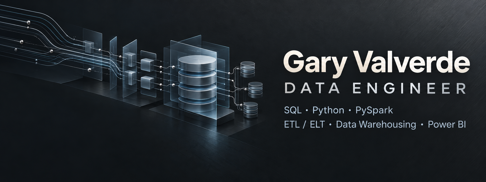

# Gary Valverde

**Data Engineer · Business Intelligence · Bolivia**

Integro fuentes operativas y preparo datos para análisis en **banca, farmacia y retail**. Trabajo con SQL, Python, PySpark y SAP Data Services, desde procesos ETL hasta Data Warehouses, modelos dimensionales y soluciones de Power BI.

[LinkedIn](https://www.linkedin.com/in/gary-german-valverde-quisbert-6b69231ab/) · [Contacto](mailto:gvalverdequisbert@gmail.com) · [Descargar CV en PDF](Gary_Valverde_CV_Data_Engineer_ES.pdf)

## Proyecto destacado

### [Voucher ETL — API REST a Oracle](https://github.com/gg-valverde/voucher-etl-oracle)

Extracción paginada de vouchers, normalización de fechas, carga por lotes a staging y consolidación con un `MERGE` set-based en Oracle.

**Qué puedes revisar:** código Python y SQL, arquitectura, decisiones técnicas, limitaciones, demo sin conexiones y pruebas automatizadas.

`Python` `API REST` `Oracle SQL` `ETL` `Staging` `Batch processing`

El repositorio contiene una adaptación pública del proyecto compartido por su autor. Los ejemplos son ficticios. La demo funciona sin API ni Oracle; la integración conectada requiere un entorno de prueba y no se presenta como un despliegue reproducido públicamente.

## Experiencia profesional

| Organización | Trabajo con datos |
| --- | --- |
| **Nexocorp / Iproject Partners S.R.L.** · Jun 2026–actualidad | Ingesta y transformación con SAP Data Services, Python y Oracle SQL; Data Warehousing y modelos de Power BI para farmacia y retail. |
| **Banco de Crédito Bolivia** · Mar–May 2026 | Procesos ETL con PySpark y Python para preparar bases analíticas en el área de Riesgos. |
| **Banco Nacional de Bolivia** · Jun 2024–Feb 2026 | Integración de fuentes, SQL Server, reportes analíticos y controles de calidad de datos. |
| **Econotec** · May 2019–May 2024 | Desarrollo de software, bases de datos relacionales y coordinación técnica. |

Las responsabilidades profesionales resumen mi trayectoria. El código y los datos internos de empleadores no forman parte de este portafolio.

## Stack principal

| Área | Tecnologías |
| --- | --- |
| Integración y transformación | SQL, Python, PySpark, SAP Data Services, ETL/ELT |
| Bases de datos y modelado | Oracle, SQL Server, T-SQL, Data Warehousing, modelado dimensional |
| Business Intelligence | Power BI, DAX, Power Query, modelos semánticos |
| Calidad y entrega | Validación de datos, optimización de consultas, automatización y documentación |

## Cómo abordo una solución

Comprender la fuente y la necesidad de negocio → definir transformaciones → validar integridad y consistencia → preparar un modelo analítico → documentar su uso y sus límites.

## Formación

- Ingeniería de Sistemas Informáticos — Universidad Privada del Valle. Título profesional expedido en 2024.
- Diplomado en Data Engineering — Universidad Privada San Francisco de Asís, 2026.

## Hablemos

Interesado en oportunidades de **Data Engineering, ETL y Business Intelligence** en Bolivia y Latinoamérica.

[gvalverdequisbert@gmail.com](mailto:gvalverdequisbert@gmail.com) · [LinkedIn](https://www.linkedin.com/in/gary-german-valverde-quisbert-6b69231ab/)
